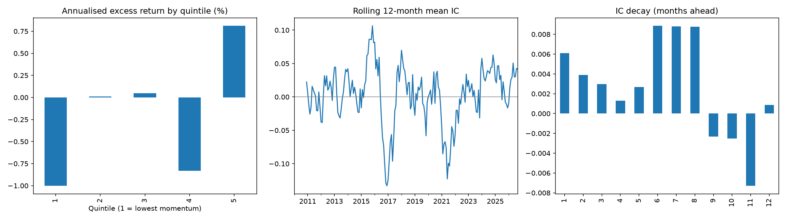
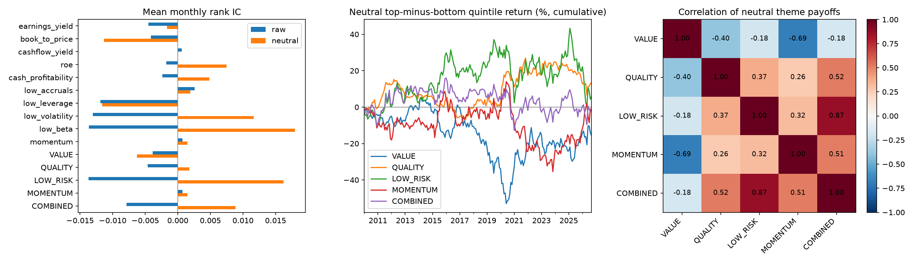
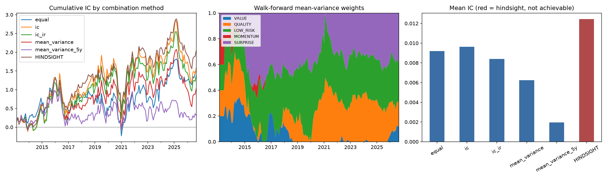

# systematic-equity

A long-only, benchmark-relative, multi-factor US equity model, built stage by stage:
data -> signals -> model -> risk -> portfolio -> backtest -> paper trading.
The design follows the process published by large systematic managers.

See [docs/METHODOLOGY.md](docs/METHODOLOGY.md) for what each stage does and how to read its output.

## Status

| Milestone | Content | State |
|---|---|---|
| 1 | Data loader, point-in-time S&P 500 universe, 12-1 momentum, IC and quintile tests | done |
| 2 | Value, quality, low-risk signals from SEC EDGAR fundamentals; sector-neutral scores; signal correlations | done |
| 2b | Trailing-twelve-month fundamentals, sales yield, gross profitability, earnings and revenue surprise | done |
| 3 | Signal combination: equal weights against walk-forward and hindsight weights | done |
| 4 | Risk model and constrained optimiser | |
| 5 | Backtest with costs and attribution | |
| 6 | IBKR paper trading | |

## Run it

```
python -m venv .venv
.venv\Scripts\activate          # macOS/Linux: source .venv/bin/activate
pip install -e ".[dev]"
pytest
python scripts/run_milestone1.py
python scripts/run_milestone2.py
python scripts/run_milestone2b.py
python scripts/run_milestone3.py
```

The first run downloads about 18 years of daily prices and caches them in `data/`.
Delete `data/*.parquet` to refresh.

Milestone 2 reads company fundamentals from SEC EDGAR, which requires a contact line.
Create a file named `.env` in the repo root (it is gitignored):

```
SEC_USER_AGENT="Your Name you@example.com"
```

## Results so far

**Milestone 1: 12-1 momentum, S&P 500, 2010-2026 (201 months).**
Mean monthly rank IC 0.006 (t = 0.42), hit rate 52%. Top-minus-bottom quintile return
1.6% a year with 16% volatility and a 41% maximum drawdown. On its own, momentum has no
statistically detectable edge in this universe and period, and it suffers sharp reversals
(2016-17, 2021-22).



**Milestone 2: four themes, scored within sector, S&P 500, 2010-2026.**
Returns are market- and sector-neutral (beta times market return removed, then sector mean).

| Theme | Mean IC | t-stat | Top minus bottom, per year |
|---|---|---|---|
| Value | -0.006 | -0.59 | -0.9% |
| Quality | 0.002 | 0.24 | 0.8% |
| Low risk | 0.016 | 1.19 | 0.3% |
| Momentum | 0.002 | 0.13 | -0.1% |
| Equal-weight combination | 0.009 | 0.86 | -0.2% |

No theme has a statistically detectable edge. On raw returns, low risk loses heavily
(a bet against a rising market); removing market exposure turns its IC from -0.014 to
+0.016. Value and momentum payoffs are strongly negatively correlated (-0.69), consistent
with Asness, Moskowitz and Pedersen (2013).



**Milestone 2b** repeats the test with trailing-twelve-month fundamentals and adds an
earnings-surprise theme; results are in `reports/m2b_signal_summary.csv`.

**Milestone 3: combining the five themes, test period 2013-2026 (164 months), neutral returns.**

| Weighting | Mean IC | t-stat |
|---|---|---|
| Equal | 0.009 | 0.79 |
| Past IC | 0.010 | 0.63 |
| Past IC consistency | 0.008 | 0.58 |
| Mean-variance, all history | 0.006 | 0.48 |
| Mean-variance, last 5 years | 0.002 | 0.18 |
| Hindsight (full-sample fit, not achievable) | 0.012 | 1.05 |

Data-driven weights, estimated from past data only, do not beat equal weights, and the more a
scheme adapts (shorter window, more parameters) the worse it does. Weights fitted with
hindsight look best. With inputs this weak, estimated weights mostly fit noise.



## Known biases in the free data

- **Survivorship**: Yahoo Finance carries few delisted stocks, so companies that failed
  or were acquired are missing. The run prints index-member price coverage per month.
- **Membership**: taken from a community-maintained history file (github.com/fja05680/sp500), not an official S&P record.

- **Fundamentals**: SEC EDGAR only lists companies that still file, so most delisted
  companies have no fundamentals. A company that re-registers with the SEC under a new
  number loses its history unless the old number is listed in `EXTRA_CIKS`.
- **Sectors**: today's GICS sectors from Wikipedia are applied to the whole history;
  stocks that have left the index are grouped as "Unknown".

These will be measured by rerunning on point-in-time data (Sharadar).

## Method notes

- Signals at month-end *t* use data up to *t* only; returns are measured from *t* to *t+1*.
  `tests/test_core.py` checks this by tampering with future prices.
- A filing is usable from the day after its SEC filing date; restatements replace earlier
  values only from the date they were filed.
- Trailing-twelve-month figures are built as year-to-date + prior full year - prior
  year-to-date, dated by the latest of the three filings. Earnings surprise is the
  year-on-year change in quarterly earnings divided by the volatility of that change.
- Signals are winsorised and z-scored within sector, so stocks are ranked against peers.
- Momentum is the 12-month return skipping the latest month (Jegadeesh and Titman, 1993).
