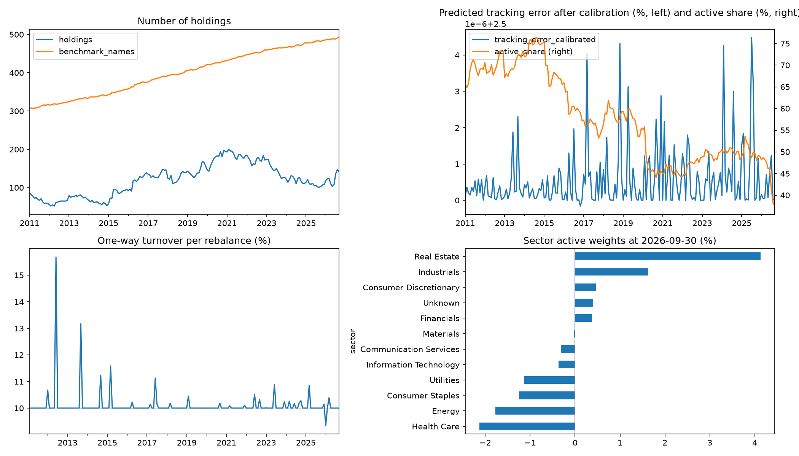
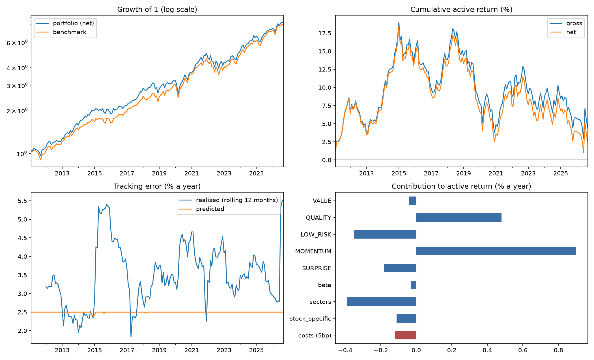

# systematic-equity

A long-only, benchmark-relative, multi-factor US equity model, built stage by stage:
data -> signals -> model -> risk -> portfolio -> backtest -> paper trading.
The design follows the process published by large systematic managers.

See [docs/METHODOLOGY.md](docs/METHODOLOGY.md) for what each stage does and how to read its output.

## Status

| Milestone | Content | State |
|---|---|---|
| 1 | Data loader, point-in-time S&P 500 universe, 12-1 momentum, IC and quintile tests | done |
| 2 | Value, quality, low-risk signals from SEC EDGAR fundamentals; sector-neutral scores; signal correlations | done |
| 2b | Trailing-twelve-month fundamentals, sales yield, gross profitability, earnings and revenue surprise | done |
| 3 | Signal combination: equal weights against walk-forward and hindsight weights | done |
| 4 | Factor risk model and constrained optimiser; monthly holdings | done |
| 5 | Backtest: performance against benchmark, trading costs, attribution by theme | done |
| 5b | Risk model comparison and calibration | done |
| 6 | IBKR paper trading | |

## Run it

```
python -m venv .venv
.venv\Scripts\activate          # macOS/Linux: source .venv/bin/activate
pip install -e ".[dev]"
pytest
python scripts/run_milestone1.py
python scripts/run_milestone2.py
python scripts/run_milestone2b.py
python scripts/run_milestone3.py
python scripts/run_milestone4.py
python scripts/run_milestone5.py
python scripts/run_risk_model_comparison.py
```

The first run downloads about 18 years of daily prices and caches them in `data/`.
Delete `data/*.parquet` to refresh.

Milestone 2 reads company fundamentals from SEC EDGAR, which requires a contact line.
Create a file named `.env` in the repo root (it is gitignored):

```
SEC_USER_AGENT="Your Name you@example.com"
```

## Results so far

**Milestone 1: 12-1 momentum, S&P 500, 2010-2026 (201 months).**
Mean monthly rank IC 0.006 (t = 0.42), hit rate 52%. Top-minus-bottom quintile return
1.6% a year with 16% volatility and a 41% maximum drawdown. On its own, momentum has no
statistically detectable edge in this universe and period, and it suffers sharp reversals
(2016-17, 2021-22).


**Milestone 2: four themes, scored within sector, S&P 500, 2010-2026.**
Returns are market- and sector-neutral (beta times market return removed, then sector mean).

| Theme | Mean IC | t-stat | Top minus bottom, per year |
|---|---|---|---|
| Value | -0.005 | -0.45 | -1.2% |
| Quality | 0.002 | 0.21 | 0.7% |
| Low risk | 0.016 | 1.19 | 0.3% |
| Momentum | 0.001 | 0.13 | -0.1% |
| Equal-weight combination | 0.008 | 0.83 | -0.1% |

No theme has a statistically detectable edge. On raw returns, low risk loses heavily
(a bet against a rising market); removing market exposure turns its IC from -0.014 to
+0.016. Value and momentum payoffs are strongly negatively correlated (-0.69), consistent
with Asness, Moskowitz and Pedersen (2013).


**Milestone 2b** repeats the test with trailing-twelve-month fundamentals and adds an
earnings-surprise theme; results are in `reports/m2b_signal_summary.csv`.

**Milestone 3: combining the five themes, test period 2013-2026 (164 months), neutral returns.**

| Weighting | Mean IC | t-stat |
|---|---|---|
| Equal | 0.010 | 0.85 |
| Past IC | 0.010 | 0.63 |
| Past IC consistency | 0.008 | 0.59 |
| Mean-variance, all history | 0.006 | 0.48 |
| Mean-variance, last 5 years | 0.002 | 0.21 |
| Hindsight (full-sample fit, not achievable) | 0.012 | 1.07 |

Data-driven weights, estimated from past data only, do not beat equal weights, and the more a
scheme adapts (shorter window, more parameters) the worse it does. Weights fitted with
hindsight look best. With inputs this weak, estimated weights mostly fit noise.


**Milestone 4: from scores to holdings, 189 monthly rebalances, 2011-2026.**
Each month a 15-factor statistical risk model is estimated from two years of daily returns,
its forecast is calibrated against its own track record, and the optimiser picks the
highest-scoring portfolio within the limits below.

| Characteristic | Average | Range | Limit |
|---|---|---|---|
| Holdings | 119 | 52 to 200 | |
| Benchmark names | 401 | 306 to 492 | |
| Active share | 58% | 38% to 76% | |
| Predicted tracking error, calibrated | 2.50% | | 2.5% |
| Risk model's own forecast | 1.73% | 1.32% to 2.50% | |
| Largest company active weight | 1.97% | 1.49% to 2.00% | 2% |
| Largest sector active weight | 5.4% | 2.4% to 6.0% | 6% |
| Active beta | -0.011 | -0.030 to 0.018 | +/-0.03 |
| One-way turnover per month | 10.1% | 9.3% to 15.7% | 10%, plus forced sales |

Every rebalance solved within its limits. The risk and trading limits bind in almost every month.



**Milestone 5: backtest of those holdings, February 2011 to September 2026 (188 months).**

| | Gross | Net of 5bp trading costs |
|---|---|---|
| Portfolio return, per year | 15.0% | 14.9% |
| Benchmark return, per year | 14.2% | 14.2% |
| Excess return, per year | 0.80% | 0.66% |
| Realised tracking error | 2.85% | 2.85% |
| Information ratio | 0.28 | 0.23 |
| t-stat of excess return | 0.98 | 0.81 |
| Beta | 0.98 | 0.98 |
| Share of months ahead of benchmark | 55% | 54% |

The excess return is positive but not statistically distinguishable from zero (t below 1),
consistent with the signal tests.

- **Costs.** One-way turnover is 121% a year. Excess return is 0.80% at zero cost, 0.51% at
  10bp per unit traded and 0.23% at 20bp.
- **Attribution.** Momentum (+0.76% a year), quality (+0.38%) and stock-specific returns
  (+0.29%) contributed; residual sector positions (-0.39%) and low risk (-0.30%) detracted.
- **Benchmark check.** The constructed benchmark's calendar-year returns are close to the
  published S&P 500 total return (for example 31.96% in 2019 and -17.24% in 2022).



**Milestone 5b: risk model accuracy.** Without calibration the model predicted 2.5% tracking
error and 3.73% was realised (bias statistic 1.50). Changing the estimation window (1 to 4
years), the number of factors (5 to 30) or adding recency weighting left the bias between 1.44
and 1.55. Calibrating the forecast against its own trailing errors, using past months only,
cut realised tracking error to 2.85% and the bias to 1.14.

| Risk model | Realised tracking error | Bias statistic |
|---|---|---|
| 2 years, 15 factors | 3.73% | 1.50 |
| 1 year / 4 years of history | 3.67% / 3.79% | 1.47 / 1.52 |
| 5 / 30 factors | 3.87% / 3.59% | 1.55 / 1.44 |
| Recency weighted, 6-month / 3-month half-life | 3.65% / 3.62% | 1.46 / 1.45 |
| 2 years, 15 factors, calibrated (used) | 2.85% | 1.14 |

Models were compared on risk accuracy only. The calibrated version also happened to produce
a higher excess return (0.80% against 0.29%); that difference is well within noise and was
not the reason for choosing it.

## Known biases in the free data

- **Survivorship**: Yahoo Finance carries few delisted stocks, so companies that failed
  or were acquired are missing. The run prints index-member price coverage per month.
- **Membership**: taken from a community-maintained history file (github.com/fja05680/sp500), not an official S&P record.

- **Fundamentals**: SEC EDGAR only lists companies that still file, so most delisted
  companies have no fundamentals. A company that re-registers with the SEC under a new
  number loses its history unless the old number is listed in `EXTRA_CIKS`.
- **Sectors**: today's GICS sectors from Wikipedia are applied to the whole history;
  stocks that have left the index are grouped as "Unknown".

- **Share counts**: XBRL share data has unit errors and double-counts companies with two
  share classes. Counts far from a company's own median are dropped, implausible market
  values are rescaled by 1,000, and identical counts across tickers are split.
- **Industries**: limits apply to sectors, not industries, so a move within a sector (for
  example semiconductors within technology) is not controlled.
- **Benchmark**: capitalisation weights over index members that have a price, a share count
  and enough return history, which is about 60% of the index in 2011 and nearly all of it by 2026.

These will be measured by rerunning on point-in-time data (Sharadar).

## Method notes

- Signals at month-end *t* use data up to *t* only; returns are measured from *t* to *t+1*.
  `tests/test_core.py` checks this by tampering with future prices.
- A filing is usable from the day after its SEC filing date; restatements replace earlier
  values only from the date they were filed.
- Trailing-twelve-month figures are built as year-to-date + prior full year - prior
  year-to-date, dated by the latest of the three filings. Earnings surprise is the
  year-on-year change in quarterly earnings divided by the volatility of that change.
- Signals are winsorised and z-scored within sector, so stocks are ranked against peers.
- Momentum is the 12-month return skipping the latest month (Jegadeesh and Titman, 1993).
